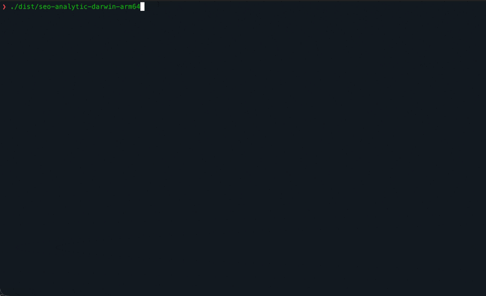

# seo-analytic

**seo-analytic** — консольная утилита на Go для быстрого анализа сайта по его адресу.
Она загружает страницу и показывает:

- **SEO-сводку с рекомендациями** — title, description, robots, canonical, язык, viewport, заголовки H1,
  картинки без `alt`, hreflang; всё, что не соответствует рекомендациям, помечается ⚠ с пояснением;
- **мета-теги** — Open Graph, Twitter Card и все остальные `<meta>`;
- **аналитику и рекламные пиксели** — Яндекс.Метрика, Google Analytics, Google Tag Manager, Facebook Pixel,
  VK Pixel, Top.Mail.ru и другие, вместе с ID счётчиков;
- **верификации вебмастеров** — Google Search Console, Яндекс.Вебмастер, Bing и др.;
- **технологии и языки** — CMS, фронтенд-фреймворки, бэкенд, сервер, CDN — в трёх режимах точности.

Работает в двух режимах: **интерактивном** (утилита сама спрашивает домен и что показать) и **через флаги**
(удобно для скриптов). Отчёт выводится текстом или в JSON. Собирается и запускается на **Windows, Linux и macOS**.



---

## Содержание

1. [Quick start](#quick-start)
2. [Использование](#использование)
3. [Что проверяется и какие даются рекомендации](#что-проверяется-и-какие-даются-рекомендации)
4. [Режимы анализа технологий](#режимы-анализа-технологий)
5. [Рендеринг в Chrome и сайты с защитой от ботов](#рендеринг-в-chrome-и-сайты-с-защитой-от-ботов)
6. [Формат JSON](#формат-json)
7. [Структура проекта](#структура-проекта)
8. [Тестирование](#тестирование)
9. [Сборка под все системы и релизы](#сборка-под-все-системы-и-релизы)
10. [Ограничения](#ограничения)
11. [Используемые технологии и пакеты](#используемые-технологии-и-пакеты)

---

## Quick start

Установленный Go для запуска **не нужен** — готовые бинарники лежат в папке [`dist/`](dist) и в релизах.

| Система | Процессор | Файл |
|---|---|---|
| Windows | x86-64 (большинство ПК) | `seo-analytic-windows-amd64.exe` |
| Windows | ARM (Snapdragon, Surface Pro X) | `seo-analytic-windows-arm64.exe` |
| Linux | x86-64 | `seo-analytic-linux-amd64` |
| Linux | ARM64 (Raspberry Pi 4/5, серверы ARM) | `seo-analytic-linux-arm64` |
| macOS | Apple Silicon (M1–M4) | `seo-analytic-darwin-arm64` |
| macOS | Intel | `seo-analytic-darwin-amd64` |

### Вариант 1. Скачать из релиза

Откройте страницу **Releases** репозитория, скачайте файл для своей системы и запустите:

```bash
# Linux / macOS
chmod +x seo-analytic-linux-amd64
./seo-analytic-linux-amd64 example.com
```

```powershell
# Windows (PowerShell или cmd)
.\seo-analytic-windows-amd64.exe example.com
```

> **Windows, проще всего:** запустите `.exe` двойным кликом — откроется интерактивный режим.
> Программа сама включает в консоли UTF-8, чтобы русский текст отображался правильно, а после отчёта
> ждёт Enter, чтобы окно не закрылось сразу. При запуске из cmd или PowerShell паузы нет.

Целостность файла можно проверить по `SHA256SUMS` из того же релиза:
`sha256sum -c SHA256SUMS --ignore-missing` (Linux), `shasum -a 256 -c SHA256SUMS --ignore-missing` (macOS).

> **macOS:** бинарник не подписан сертификатом Apple, поэтому скачанный из браузера файл Gatekeeper
> заблокирует. Снимите карантин: `xattr -d com.apple.quarantine seo-analytic-darwin-arm64`.
>
> **Windows:** SmartScreen может предупредить о неизвестном издателе — «Подробнее» → «Выполнить в любом случае».

### Вариант 2. Склонировать и запустить готовый бинарник

```bash
git clone https://github.com/EvgeniiShumeiko/seo-analytic.git
cd seo-analytic
./dist/seo-analytic-darwin-arm64            # macOS Apple Silicon — интерактивный режим
./dist/seo-analytic-linux-amd64 lenta.ru    # Linux — сразу отчёт по сайту
```

```powershell
.\dist\seo-analytic-windows-amd64.exe lenta.ru
```

### Вариант 3. Собрать из исходников

Нужен [Go](https://go.dev/dl/) 1.26 или новее.

```bash
git clone https://github.com/EvgeniiShumeiko/seo-analytic.git
cd seo-analytic
go run ./cmd/seo-analytic lenta.ru        # запустить без сборки
go build -o seo-analytic ./cmd/seo-analytic   # собрать бинарник (на Windows: -o seo-analytic.exe)
```

### Пример вывода

```text
$ seo-analytic lenta.ru
URL: https://lenta.ru (HTTP 200, десктоп)

== SEO ==
  Title:         Lenta.ru - Новости России и мира сегодня
  Description:   Новости, статьи, фотографии, видео. Семь дней в неделю, 24 часа в сутки.
  Keywords:      —
  Robots:        —
  Canonical:     https://lenta.ru/
  Lang:          ru
  Viewport:      —  ⚠ нет — плохо для мобильных
  H1:            —  ⚠ найдено 0, рекомендуется ровно один
  Изображения:   110  ⚠ 109 без alt

== Open Graph ==
  og:description: Новости, статьи, фотографии, видео. Семь дней в неделю, 24 часа в сутки.
  og:type:       article
  og:image:      https://icdn.lenta.ru/assets/webpack/images/lenta_og.04ceff52.png
  og:site_name:  Lenta.RU
  og:title:      Лента.Ру

== Twitter Card ==
  —

== Прочие meta ==
  charset:       utf-8
  theme-color:   #292929

== Аналитика, пиксели, верификация ==
  ✓ Яндекс.Метрика  [27714477]
  ✓ Top.Mail.ru / VK Ads  [3311946]

== Технологии и языки (простой анализ) ==
  ✓ nginx (Сервер)
```

---

## Использование

```text
seo-analytic [-mobile] [-json] [-render] [-tech simple|deep|chrome] [url]
```

Адрес можно указывать без протокола — `example.com` превращается в `https://example.com`.

### Интерактивный режим

Запуск **без адреса** открывает пошаговую форму в терминале:

1. **Домен или URL** сайта.
2. **Что показать** — список разделов с галочками (по умолчанию отмечены все):
   SEO, Open Graph, Twitter Card, Прочие meta, Аналитика/пиксели/верификация, Технологии и языки.
   Пробел — отметить, `Ctrl+A` — отметить всё / снять всё, `Enter` — дальше.
3. **Анализ технологий** — простой, углублённый или экспериментальный
   (вопрос появляется, только если отмечен раздел «Технологии и языки»).
4. **Версия сайта** — десктопная, мобильная или обе (тогда будет два отчёта подряд).
5. **Рендерить в Chrome?** — да/нет (не спрашивается, если выбран экспериментальный режим — он рендерит всегда).

`Ctrl+C` в любой момент — выход без анализа. Флаг `-json` работает и в интерактивном режиме:
форма рисуется в stderr, поэтому `seo-analytic -json > report.json` сохранит в файл только отчёт.

### Флаги

| Флаг | По умолчанию | Что делает |
|---|---|---|
| `-mobile` | выкл. | запросить страницу как мобильный браузер (iPhone Safari): многие сайты отдают телефонам другую вёрстку |
| `-json` | выкл. | вывести отчёт в JSON вместо текста |
| `-tech simple` | ✓ | простой анализ технологий — ~30 собственных сигнатур, мгновенно |
| `-tech deep` | | углублённый — база правил Wappalyzer (тысячи технологий) + простой |
| `-tech chrome` | | экспериментальный — углублённый + проверка JS-объектов страницы в Chrome; включает `-render` |
| `-render` | выкл. | открыть страницу в headless Chrome и анализировать DOM после выполнения JS |

### Примеры

```bash
seo-analytic                                  # интерактивный режим
seo-analytic example.com                      # все разделы, десктоп, простой анализ
seo-analytic -mobile example.com              # мобильная версия
seo-analytic -tech deep example.com           # углублённый анализ технологий
seo-analytic -tech chrome vuejs.org           # экспериментальный: найдёт Vue.js с точной версией
seo-analytic -render example.com              # DOM после JS — видны трекеры, подгружаемые через GTM
seo-analytic -json example.com > report.json  # отчёт для дальнейшей обработки
```

Коды завершения: `0` — успех, `1` — ошибка (сеть, Chrome не найден и т.п.), `2` — неверные аргументы,
`130` — прервано пользователем.

---

## Что проверяется и какие даются рекомендации

Рекомендации выводятся прямо в отчёте строкой `⚠` рядом с проблемным полем.

| Параметр | Откуда берётся | Когда ⚠ |
|---|---|---|
| Title | `<title>` | отсутствует или длина вне 10–60 символов (длиннее обрезается в выдаче) |
| Description | `<meta name="description">` | отсутствует или длина вне 50–160 символов |
| Robots | `<meta name="robots">` | содержит `noindex` — страница закрыта от индексации |
| Lang | `<html lang>` | не указан — поисковику сложнее определить язык |
| Viewport | `<meta name="viewport">` | отсутствует — страница плохо отображается на телефонах |
| H1 | все `<h1>` | ни одного или больше одного |
| Изображения | все `` | есть картинки без `alt` (доступность и поиск по картинкам) |
| Canonical, Keywords, hreflang | `<link rel="canonical">`, `<meta name="keywords">`, `<link rel="alternate" hreflang>` | выводятся для сведения |

Длина считается в символах, а не в байтах, поэтому кириллица оценивается корректно.
Страницы в `windows-1251` и других кодировках автоматически перекодируются в UTF-8.

**Аналитика и пиксели:** Google Analytics 4, Universal Analytics, Google Tag Manager, Google Ads,
Яндекс.Метрика, Facebook Pixel, VK Pixel, Top.Mail.ru / VK Ads, TikTok Pixel, Microsoft Clarity,
Bing UET, Hotjar, LinkedIn Insight, Pinterest Tag. Если в коде есть ID счётчика, он выводится в скобках.

**Верификации:** Google Search Console, Яндекс.Вебмастер, Bing Webmaster, Mail.ru Webmaster,
Facebook Domain Verification, Pinterest — вместе с кодом подтверждения.

---

## Режимы анализа технологий

| | `simple` | `deep` | `chrome` (экспериментальный) |
|---|---|---|---|
| Что использует | ~30 своих сигнатур | база правил Wappalyzer + simple | deep + JS-объекты страницы в Chrome |
| Источники | HTML, заголовки, cookie, `meta generator` | то же | то же + `window.*`, служебные поля фреймворков на DOM-узлах |
| Скорость | мгновенно | +~1 с на разбор базы правил | ~10 с (запуск Chrome) |
| Нужен Chrome | нет | нет | да |
| Категории | на русском | на английском (из Wappalyzer) | смешанные |

**Почему режимы дополняют друг друга.** Часть правил Wappalyzer рассчитана на проверку JS-объектов
в браузере, поэтому без рендеринга они не срабатывают — например, Next.js на nextjs.org база не видит,
а простые сигнатуры (`__NEXT_DATA__`, `/_next/static/`) — видят. Поэтому `deep` всегда включает
находки `simple`, а `chrome` — находки `deep`. Пример разницы:

| Сайт | `simple` | `chrome` |
|---|---|---|
| nextjs.org | Next.js, Vercel | React, Next.js **16.5.0-canary.49**, Vercel, HSTS |
| vuejs.org | Vue.js (без версии), VitePress, Netlify | Vue.js **3.5.42**, VitePress, Netlify, Fathom |

**Языки бэкенда** выводятся как «вероятные»: в `simple` — по найденным технологиям
(WordPress → PHP, Django → Python), в `deep` — по категории «Programming languages» Wappalyzer.

JS-проверки экспериментального режима лежат в [`internal/render/probes.js`](internal/render/probes.js):
React, Vue, Angular/AngularJS, SvelteKit, Next.js, Nuxt, Gatsby, Remix, Ember, Backbone, Alpine.js, htmx,
jQuery, Lodash, Moment.js, Apollo, webpack, Sentry, 1С-Битрикс, WordPress, Shopify, Tilda.

---

## Рендеринг в Chrome и сайты с защитой от ботов

С флагом `-render` (и в режиме `-tech chrome`) страница открывается в настоящем headless Chrome
через протокол DevTools. Отчёт строится по **одному** ответу, который получил браузер: статус, заголовки,
cookie и DOM после выполнения JavaScript. Это даёт:

- SPA-сайты (React, Vue…), у которых исходный HTML почти пустой;
- трекеры, которые подгружаются через Google Tag Manager уже после загрузки страницы;
- корректную мобильную эмуляцию: размер экрана 390×844, тач, мобильный User-Agent.

Нужен установленный **Chrome, Chromium или Edge** — chromedp сам ищет его в стандартных путях
Windows, Linux и macOS. В Docker/CI под root Chrome запускается с `--no-sandbox` автоматически.

**Защита от ботов.** Некоторые сайты (например, за ServicePipe, Cloudflare, DDoS-Guard, Qrator)
блокируют обычные HTTP-запросы и отдают свою страницу с кодом 403/429/503. Утилита это распознаёт
и спрашивает:

```text
┃ Сайт защищён от ботов (ServicePipe)
┃ Обычный запрос заблокирован. Получить данные через рендеринг в Chrome?
┃ Это медленнее (~10 с) и нужен установленный Chrome/Chromium/Edge.
┃                              Да     Нет
```

- **Да** — запрос повторяется через Chrome, как у обычного посетителя;
- **Нет** — выводится отчёт по странице блокировки с предупреждением, что это не сам сайт.

Без терминала (скрипты, CI) вопрос не задаётся: отчёт помечается предупреждением, в JSON — полем
`blocked_by`. Утилита **не обходит** защиту (не подделывает сетевые отпечатки, не перебирает заголовки
и прокси): если владелец сайта не пускает и браузер, отчёт честно это покажет. Для своих сайтов
правильный путь — добавить IP или User-Agent в белый список в панели защиты.

---

## Формат JSON

`-json` выводит **массив** — по элементу на каждую проверенную версию сайта (десктоп / мобильная).
Невыбранные разделы в JSON отсутствуют, выбранные, но пустые — выводятся как `[]`, чтобы можно было
отличить «не проверяли» от «ничего не нашли».

```json
[
  {
    "url": "https://lenta.ru",
    "device": "desktop",
    "status": 200,
    "rendered": false,
    "seo": {
      "title": "Lenta.ru - Новости России и мира сегодня",
      "description": "Новости, статьи, фотографии, видео. Семь дней в неделю, 24 часа в сутки.",
      "keywords": "",
      "robots": "",
      "canonical": "https://lenta.ru/",
      "lang": "ru",
      "viewport": "",
      "h1": [],
      "images": 110,
      "images_no_alt": 109,
      "hreflang": []
    },
    "open_graph": [{ "key": "og:type", "content": "article" }],
    "twitter": [],
    "other_meta": [{ "key": "charset", "content": "utf-8" }],
    "trackers": [
      { "name": "Яндекс.Метрика", "details": ["27714477"] },
      { "name": "Top.Mail.ru / VK Ads", "details": ["3311946"] }
    ],
    "tech_mode": "simple",
    "technologies": [{ "name": "nginx", "category": "Сервер" }],
    "languages": []
  }
]
```

| Поле | Описание |
|---|---|
| `url`, `status` | итоговый адрес после редиректов и HTTP-код |
| `device` | `desktop` или `mobile` |
| `rendered` | страница получена через Chrome |
| `blocked_by` | есть, только если получена страница блокировки защиты от ботов |
| `seo` | SEO-сводка (без предупреждений — они только в текстовом отчёте) |
| `open_graph`, `twitter`, `other_meta` | мета-теги `{key, content}` в порядке документа |
| `trackers` | счётчики и верификации; `details` — ID или код подтверждения |
| `tech_mode`, `technologies`, `languages` | режим, найденные технологии (`details` — версия), языки |

---

## Структура проекта

Раскладка следует стандартной для Go схеме: исполняемые программы — в `cmd/`, внутренние пакеты —
в `internal/` (компилятор Go не даёт импортировать их извне модуля). Каждый пакет отвечает за одну задачу.

```text
seo-analytic/
├── cmd/seo-analytic/        точка входа
│   ├── main.go              флаги, выбор режима, цикл по версиям сайта, вывод
│   ├── form.go              интерактивная форма и вопрос про Chrome (huh)
│   ├── console_windows.go   только Windows: UTF-8 в консоли и пауза при запуске двойным кликом
│   └── console_other.go     Linux/macOS: пустая заглушка
├── internal/
│   ├── fetch/               загрузка страницы обычным HTTP-запросом
│   │   ├── fetch.go         User-Agent десктопа/телефона, таймаут, перекодировка в UTF-8
│   │   └── protection.go    распознавание страниц блокировки защиты от ботов
│   ├── render/              загрузка страницы через headless Chrome (chromedp)
│   │   ├── render.go        запуск браузера, эмуляция устройства, ответ + DOM + cookie
│   │   └── probes.js        JS-проверки технологий, вшиваются в бинарник (go:embed)
│   ├── page/                разбор HTML: title, meta, canonical, hreflang, H1, картинки
│   ├── detect/              поиск по странице
│   │   ├── detect.go        общий тип Hit и вспомогательные функции
│   │   ├── trackers.go      счётчики, пиксели, верификации
│   │   ├── tech.go          простой анализ технологий (свои сигнатуры)
│   │   └── deep.go          углублённый анализ (Wappalyzer)
│   └── report/              отчёт
│       ├── report.go        разделы, режимы, структура Result для текста и JSON
│       └── text.go          текстовый вывод с рекомендациями ⚠
├── docs/demo.gif            запись работы для README
├── dist/                    готовые бинарники под 6 платформ + SHA256SUMS
├── scripts/
│   ├── build.sh             сборка dist/ на Linux/macOS
│   └── build.bat            сборка dist/ на Windows (cmd или двойной клик)
├── .github/workflows/
│   └── release.yml          тесты, сборка и публикация релиза по тегу v*
├── .gitattributes           переводы строк: CRLF для .bat, LF для .sh
├── go.mod, go.sum           зависимости
└── README.md
```

### Как проходят данные

```text
            аргументы / интерактивная форма (cmd)
                          │
          ┌───────────────┴────────────────┐
          ▼                                ▼
   fetch.Get (HTTP)                render.Page (Chrome)
          │     └─ защита от ботов? → спросить → ┘
          └───────────────┬────────────────┘
                          ▼  fetch.Response: URL, статус, заголовки, HTML
                    report.Build
          ┌───────────────┼──────────────────┐
          ▼               ▼                  ▼
     page.Parse    detect.Trackers   detect.Tech / TechDeep
          └───────────────┼──────────────────┘
                          ▼  report.Result
              report.Print (текст)  |  encoding/json (JSON)
```

### Ключевые решения

- **Один тип ответа для HTTP и Chrome** (`fetch.Response`). Отчёт не знает, откуда пришла страница,
  поэтому рендеринг добавлен без изменений в анализаторах.
- **Один `Result` и для текста, и для JSON.** Текстовый вывод — это просто другое представление тех же
  данных, поэтому форматы не расходятся.
- **Сигнатуры — данные, а не код.** Трекеры и технологии описаны таблицами регулярных выражений:
  чтобы добавить новый счётчик, достаточно одной строки в `trackers.go`.
- **Ленивые тяжёлые части.** База Wappalyzer разбирается только при `-tech deep|chrome`
  (`sync.OnceValues`), Chrome запускается только при `-render`.
- **Платформенный код изолирован build-тегами.** Всё, что нужно только Windows (кодировка консоли,
  пауза при двойном клике), лежит в `console_windows.go`; на остальных системах компилируется
  пустая заглушка `console_other.go`. Выход из программы идёт через одну точку (`run() int`), потому что
  `os.Exit` пропускает `defer` — иначе кодировка консоли не вернулась бы при ошибке.
- **Только чистый Go, без CGO** — поэтому кросс-компиляция под любую систему делается одной командой.

---

## Тестирование

```bash
go test ./...          # все тесты
go test -v ./internal/render   # тест рендеринга (пропускается, если Chrome не установлен)
go vet ./...           # статический анализ
```

| Пакет | Что проверяется |
|---|---|
| `page` | разбор title (в том числе игнор `<title>` внутри SVG), meta, canonical, hreflang, H1, alt |
| `detect` | ID счётчиков GA4, Метрики, Facebook; верификация Яндекса; версии PHP и jQuery; отсутствие ложных срабатываний; что `deep` подхватывает находки `simple` |
| `fetch` | распознавание ServicePipe, Cloudflare, DDoS-Guard, капчи; что обычный 403 и заголовки защиты на нормальной странице не считаются блокировкой |
| `report` | невыбранный раздел пропадает из JSON, выбранный пустой — остаётся как `[]` |
| `render` | на локальном тестовом сервере: DOM после выполнения JS, версии jQuery и Vue из JS-объектов, статус и заголовки берутся из ответа Chrome |

Сетевые тесты не ходят в интернет — используются заготовки HTML и локальный `httptest`-сервер.

---

## Сборка под все системы и релизы

Скрипты собирают бинарники под 6 платформ в `dist/` и считают контрольные суммы:

```bash
./scripts/build.sh                                         # Linux / macOS
```

```bat
scripts\build.bat
```

На Windows `build.bat` можно запустить из `cmd`, из PowerShell или двойным кликом в Проводнике —
в последнем случае окно не закроется, пока не нажать клавишу. Нужен установленный Go 1.26+;
контрольные суммы считаются встроенной утилитой `certutil`.
Файл `.gitattributes` следит, чтобы `.bat` хранился с переводами строк Windows (CRLF) —
с переводами Linux (LF) `cmd.exe` неправильно обрабатывает переходы `goto`.

Под капотом для каждой платформы выполняется
`CGO_ENABLED=0 GOOS=<os> GOARCH=<arch> go build -trimpath -ldflags "-s -w" ./cmd/seo-analytic`:
`-trimpath` убирает из бинарника локальные пути, `-s -w` — отладочную информацию (минус ~25% размера).
Размер одного бинарника — около 15 МБ, большую часть занимает встроенная база Wappalyzer.

**Релизы.** Workflow [`.github/workflows/release.yml`](.github/workflows/release.yml) запускается
при пуше тега: прогоняет `go vet` и тесты, собирает `dist/` и публикует все файлы в GitHub Releases.

```bash
git tag v1.0.0
git push origin v1.0.0
```

---

## Ограничения

- **Без `-render` JavaScript не выполняется** — анализируется исходный HTML и заголовки. Трекеры из GTM
  и признаки SPA, видимые только после рендеринга, в этом режиме не обнаруживаются.
- **Пауза после загрузки в Chrome фиксирована — 2 секунды.** Очень медленные отложенные скрипты
  могут не успеть загрузиться.
- **Распознавание технологий эвристическое.** Возможны ложные срабатывания (cookie `csrftoken` бывает
  не только у Django) и пропуски.
- **JS-проверки экспериментального режима** опираются на внутренние поля фреймворков и могут перестать
  работать в их будущих версиях.
- **Защита от ботов** распознаётся только для известных сервисов и по слову «captcha» на странице.
- **Анализируется одна страница**, а не весь сайт: robots.txt, sitemap.xml и внутренние ссылки не обходятся.
- Программа сама включает UTF-8 в консоли Windows, но в старой консоли `cmd.exe` со шрифтом
  по умолчанию символы ✓ и ⚠ всё равно могут отображаться квадратиками — используйте Windows Terminal.

---

## Используемые технологии и пакеты

**Язык:** [Go](https://go.dev) 1.26+ (используются итераторы `iter.Seq`, `sync.OnceValues`,
тег JSON `omitzero`, `go:embed`).

### Внешние зависимости

| Пакет | Версия | Лицензия | Для чего |
|---|---|---|---|
| [golang.org/x/net/html](https://pkg.go.dev/golang.org/x/net/html) | v0.62.0 | BSD-3-Clause | HTML-парсер по спецификации HTML5 (в стандартной библиотеке его нет) |
| [golang.org/x/net/html/charset](https://pkg.go.dev/golang.org/x/net/html/charset) | v0.62.0 | BSD-3-Clause | определение кодировки страницы и перекодировка в UTF-8 |
| [charm.land/huh/v2](https://github.com/charmbracelet/huh) | v2.0.3 | MIT | интерактивные формы в терминале: поля ввода, списки с галочками, да/нет |
| [github.com/charmbracelet/x/term](https://github.com/charmbracelet/x) | v0.2.2 | MIT | проверка, запущена ли программа в терминале (кроссплатформенно) |
| [golang.org/x/sys/windows](https://pkg.go.dev/golang.org/x/sys/windows) | v0.49.0 | BSD-3-Clause | только Windows: кодировка консоли и проверка запуска двойным кликом |
| [github.com/projectdiscovery/wappalyzergo](https://github.com/projectdiscovery/wappalyzergo) | v0.3.9 | MIT | углублённое распознавание технологий по базе правил Wappalyzer |
| [github.com/chromedp/chromedp](https://github.com/chromedp/chromedp) | v0.23.0 | MIT | управление headless Chrome через протокол DevTools |
| [github.com/chromedp/cdproto](https://github.com/chromedp/cdproto) | v0.159.0 | MIT | типы протокола DevTools (ответ сервера, cookie) |

Остальные модули в `go.mod` — транзитивные зависимости перечисленных пакетов.

### Стандартная библиотека Go

| Пакет | Для чего |
|---|---|
| `net/http` | HTTP-запросы, заголовки, коды ответа; `net/http/httptest` — тестовый сервер |
| `regexp` | сигнатуры трекеров и технологий |
| `encoding/json` | вывод отчёта в JSON |
| `flag` | разбор аргументов командной строки |
| `embed` | встраивание `probes.js` в бинарник |
| `context`, `sync`, `slices`, `strings`, `io` | таймауты Chrome, ленивая инициализация, работа с данными |
| `testing` | модульные тесты |

### Инструменты

| Инструмент | Для чего |
|---|---|
| `go vet`, `gofmt` | статический анализ и единый стиль кода |
| GitHub Actions | автоматические тесты, сборка и публикация релизов |
| Google Chrome / Chromium / Edge | нужен только для `-render` и `-tech chrome` |
